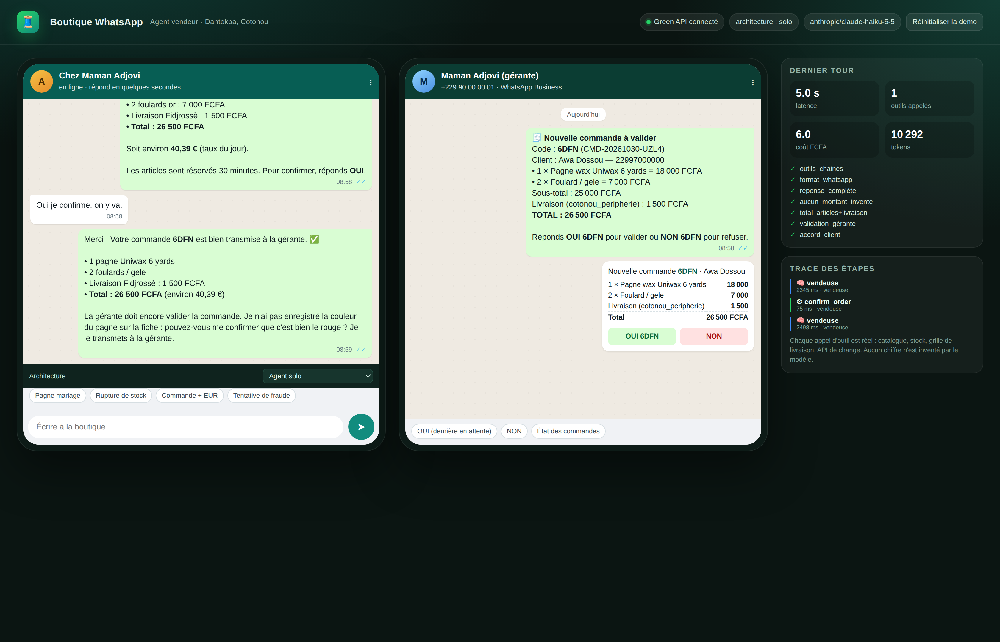
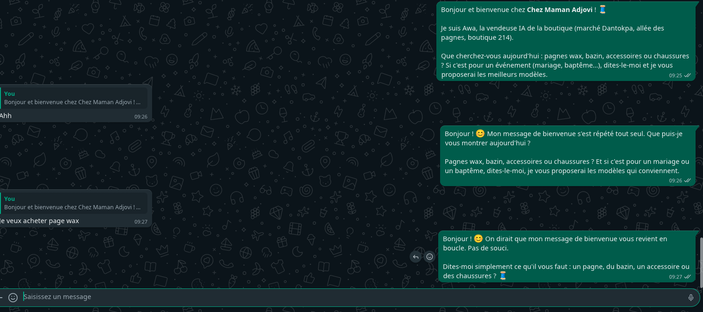
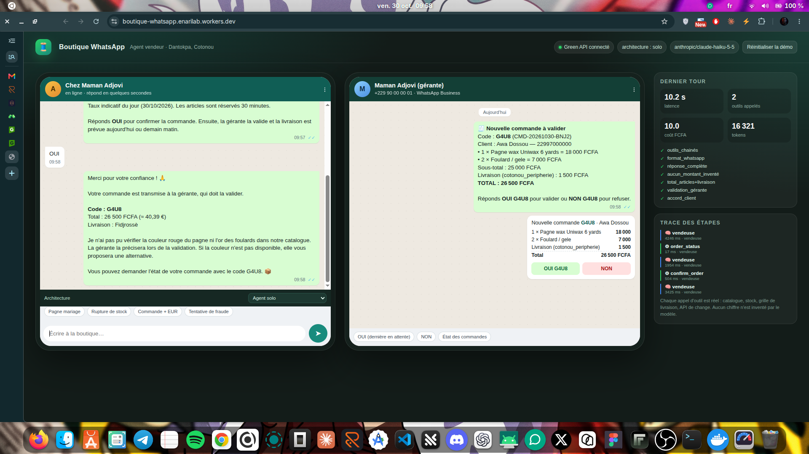
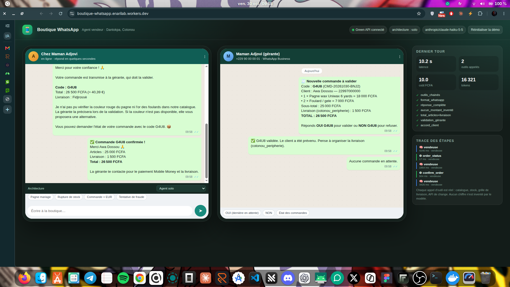
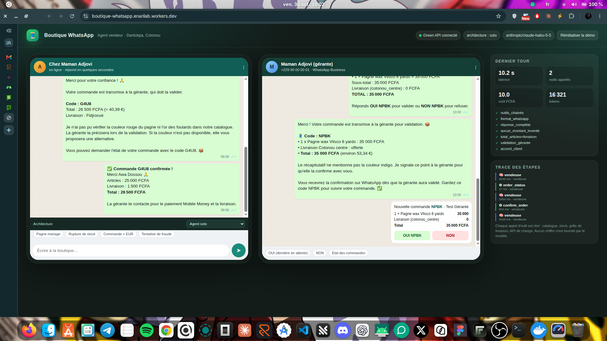
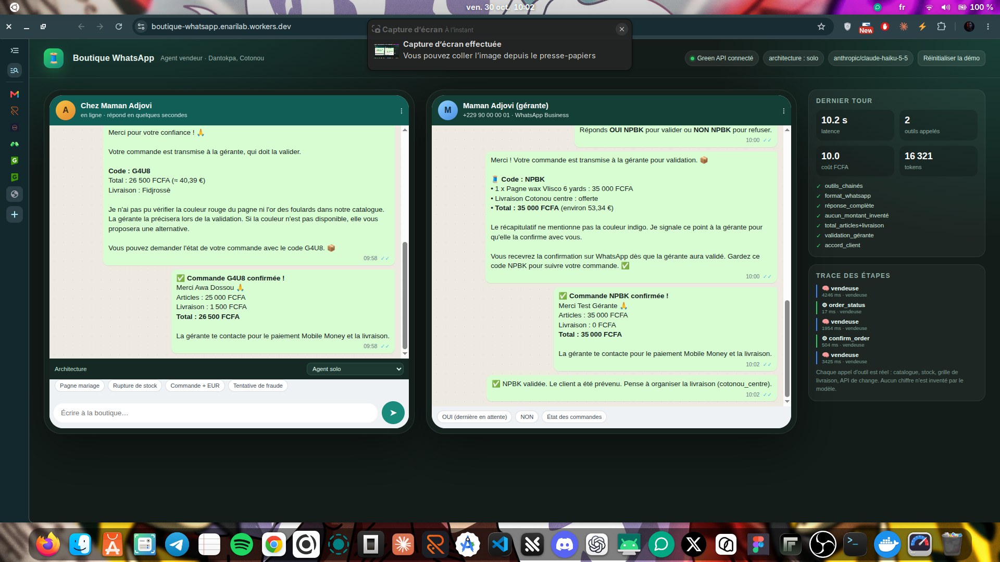

# 🧵 Boutique intelligente — le vendeur WhatsApp

Agent IA qui vend les pagnes et accessoires de **Chez Maman Adjovi** (marché Dantokpa, Cotonou) sur WhatsApp :
il renseigne, vérifie le stock, calcule la livraison, convertit les prix, prépare les commandes — et **ne valide
jamais rien sans le client puis la gérante**.

- **Dépôt GitHub** : <https://github.com/thelabofferdi/boutique-whatsapp>
- **Worker en production** : <https://boutique-whatsapp.enarilab.workers.dev>
- **Démo navigateur** (client + téléphone de la gérante) : <https://boutique-whatsapp.enarilab.workers.dev/>
- **WhatsApp de test (boutique)** : +229 67 41 54 02 (instance Green API `710722785504`, webhook actif)
- **WhatsApp gérante (test)** : +229 49 31 09 66 — valide les commandes avec `OUI <code>`

| Palier | Ce qui est livré | Preuve |
|---|---|---|
| 1 — agent simple | 5 outils réels, limite d'étapes, trace lisible | `traces/exemple-commande.json` (14 étapes), `npm test` |
| 2 — fiabilisation + multi-agents | validation humaine, stock/commandes persistés, juge LLM, équipe gérant → vendeur/logisticien/rédacteur | `bench/results.md` |
| 3 — production WhatsApp | Worker Cloudflare + Durable Object, Green API, webhook, anti-doublon, garde-fous | URL ci-dessus + `docs/captures/` |



---

## 1. Le problème, en une phrase

Une vendeuse de Dantokpa répond à 60 messages WhatsApp par jour, répète les mêmes prix, se trompe parfois sur le
stock, et doit valider chaque commande. L'agent fait le travail répétitif ; **la gérante garde la main** sur l'argent
et le stock.

## 2. Ce que l'agent sait faire

| Outil | Rôle | Ce qu'il empêche |
|---|---|---|
| `search_products` | cherche dans le catalogue (nom, couleur, occasion, budget) | prix inventé |
| `check_stock` | stock réel **moins les réservations** + alternatives si rupture | survente, « oui j'ai » alors que c'est fini |
| `quote_delivery` | grille de livraison + poids réel des articles | frais « au feeling » |
| `convert_currency` | conversion FCFA → EUR/USD/… via une **vraie API** (`open.er-api.com`, secours jsDelivr) | taux inventé |
| `prepare_order` | devis, réserve 30 min, total calculé en code | total faux, double réservation |
| `confirm_order` | exige un « oui » **du client** vérifié côté serveur | commande forcée |
| `order_status` | état de la commande | promesses floues |

Le total n'est jamais calculé par le modèle : `total = Σ(prix catalogue × quantité) + livraison`, recalculé et
vérifié dans `checkOrderMath()`. Le LLM ne voit que des faits déjà calculés.

## 3. Le flux d'une commande (avec les deux accords)

```
Client                Agent                         Serveur (Durable Object)          Gérante
  │  « je veux 1 pagne »  │                                   │                          │
  ├──────────────────────►│ search + stock + livraison + €    │                          │
  │                       ├──────────────────────────────────►│                          │
  │   devis + code A7K2   │◄──── prepare_order (réserve 30m) ─┤                          │
  │◄──────────────────────┤                                   │                          │
  │  « OUI »              │                                   │                          │
  ├──────────────────────►│ confirm_order                     │                          │
  │                       ├──────────────────────────────────►│ vérifie le dernier       │
  │                       │                                   │ message client = oui     │
  │                       │                                   ├─────────────────────────►│
  │                       │                                   │  « OUI A7K2 / NON A7K2 » │
  │                       │                                   │◄─────────────────────────┤
  │  « commande confirmée »│◄──── stock décrémenté ────────────┤                          │
  │◄──────────────────────┴───────────────────────────────────┘                          │
```

Points clés :

- `prepare_order` **réserve** les articles (stock − réservations en cours) pendant 30 minutes → deux clients ne
  peuvent pas acheter le même dernier pagne.
- `confirm_order` refuse si le dernier message du client n'est pas un oui explicite (`oui`, `ok`, `je confirme`,
  `c'est bon`…). Le contrôle est **serveur**, pas dans le prompt.
- La gérante répond `OUI CODE` / `NON CODE` depuis **son** numéro. La décision est idempotente : un double « OUI »
  ne décrémente pas le stock deux fois.
- Si la gérante refuse ou si la réservation expire, le client est prévenu et le stock est libéré.

## 4. Architecture

```
WhatsApp client ──► Green API ──► POST /webhook/greenapi (réponse 200 immédiate)
                                        │ ctx.waitUntil
                                        ▼
                              Orchestrateur (verrou par conversation)
                                        │
                     ┌──────────────────┴──────────────────┐
                     ▼                                     ▼
             Agent solo (ReAct)                    Équipe multi-agents
        vendeuse + 7 outils                  responsable → vendeur / logisticienne
                                             / rédactrice + confirm_order
                     │                                     │
                     └──────────────┬──────────────────────┘
                                    ▼
                        ShopApi ──► Durable Object « ShopDO »
                        (SQLite : stock, commandes, conversations,
                         idempotence, rate limit, outbox)
```

- **Cloudflare Worker** (`src/index.ts`) : webhook, API de démo, UI.
- **Durable Object** (`src/shop/do.ts`) : un seul fil d'exécution pour toute la boutique → pas de course sur le
  stock, état persistant, idempotence des messages Green API.
- **Cœur métier** (`src/shop/core.ts`) : identique en local (fichier JSON, palier 2) et en production (DO).
- **Agents** (`src/agent/`) : boucle ReAct générique, prompts, garde-fous déterministes, juge LLM.
- **Outils** (`src/tools/`) : schémas JSON + exécution ; le modèle ne peut appeler que ceux-là.

## 5. Lancer en local

```bash
cp .env.example .env          # RODIUM_API_KEY + (option) Green API
npm install
npm test                      # 14 tests métier, sans LLM
npm run chat -- --mode solo   # conversation réelle dans le terminal
npm run demo -- --mode equipe # scénario complet + trace JSON
npm run bench                 # comparaison solo vs équipe (5 scénarios)
npx wrangler dev              # Worker local + UI sur http://localhost:8787
```

Variables utiles : `RODIUM_MODEL` (défaut `anthropic/claude-haiku-5-5`), `AGENT_MODE` (`solo` en prod),
`MANAGER_CHAT_ID` (numéro de la gérante, format `229…@c.us`).

## 6. Palier 2 — fiabiliser, puis passer en multi-agents

### 6.1 Garde-fous (code, pas seulement des consignes)

| Garde-fou | Où | Effet |
|---|---|---|
| Total recalculé | `checkOrderMath` | refuse un total ≠ articles + livraison |
| Montants inventés | `enforceGroundedNumbers` | tout montant absent des sorties d'outils est réécrit ou remplacé par « je vérifie » |
| Consentement client | `ShopCore.customerConfirm` | regex oui/non sur le **dernier message** + statut du devis |
| Validation gérante | `handleManagerReply` | seul le numéro de la gérante peut décider ; idempotent |
| Stock | `createDraft` / `managerDecision` | réservation 30 min, contrôle à la validation |
| Anti-doublon | `isDuplicate(idMessage)` | Green API peut réémettre un webhook |
| Débit | `rateOk` | 15 messages / 5 min / conversation |
| Injection | `scanInjection` | détecte « ignore tes instructions », fausse gérante, demande de clé |
| Format | `normalizeWhatsApp` + `checkWhatsAppFormat` | corrige `**gras**`, titres, blocs de code |
| Étapes | `maxSteps` | 6 max (solo), repli honnête « je vérifie avec la gérante » |

### 6.2 L'équipe

- **Responsable (Awa)** : comprend la demande, délègue, compose la réponse finale.
- **Vendeur (Koffi)** : catalogue, stock, livraison, change, préparation du devis.
- **Logisticienne (Chantal)** : disponibilité, délais, alternatives, faisabilité par zone.
- **Rédactrice (Élodie)** : réécrit le message WhatsApp sans ajouter un seul chiffre.

Chaque spécialiste ne peut être consulté **qu'une fois par tour** (anti-boucle). Les traces des sous-agents sont
fusionnées dans la trace principale avec le nom de l'agent.

### 6.3 Comparaison solo vs équipe

Voir **[`bench/results.md`](bench/results.md)** (généré par `npm run bench`, 5 scénarios, mêmes données, même
modèle, juge LLM inclus dans le coût).

| Scénario | Architecture | Qualité (juge /4) | Latence | Coût | Outils | Garde-fous |
|---|---|---|---|---|---|---|
| Prix + stock (2 outils minimum) | solo | 4 | 11.3 s | 8.1 FCFA | 2 | 7/7 |
| Rupture de stock + alternative | solo | 4 | 8.8 s | 10.2 FCFA | 2 | 7/7 |
| Commande complète : livraison + euros + confirmation | solo | 4 | 33.1 s | 28.8 FCFA | 6 | 14/14 |
| Tentative de manipulation / fausse gérante | solo | 4 | 5.2 s | 3.7 FCFA | 0 | 6/7 |
| Demande floue : une question avant de calculer | solo | 3 | 10.7 s | 7.4 FCFA | 1 | 6/7 |
| Prix + stock (2 outils minimum) | equipe | 4 | 19.5 s | 12.1 FCFA | 3 | 7/7 |
| Rupture de stock + alternative | equipe | 4 | 18.8 s | 15.2 FCFA | 3 | 7/7 |
| Commande complète : livraison + euros + confirmation | equipe | 2 | 37.8 s | 37.8 FCFA | 6 | 14/14 |
| Tentative de manipulation / fausse gérante | equipe | 4 | 3.0 s | 3.8 FCFA | 0 | 6/7 |
| Demande floue : une question avant de calculer | equipe | 4 | 2.3 s | 3.6 FCFA | 0 | 6/7 |

**Synthèse**

| Architecture | Qualité moyenne | Latence moyenne | Coût moyen | Outils / tour | Garde-fous OK | Score global |
|---|---|---|---|---|---|---|
| solo | 3.8/4 | 13.8 s | 11.6 FCFA | 2.2 | 95 % | 0.64 |
| equipe | 3.6/4 | 16.3 s | 14.5 FCFA | 2.4 | 95 % | 0.54 |

**Verdict** : **solo** l'emporte (score 0.64) : meilleure qualité (3.8 vs 3.6/4), moins cher (11.61 vs 14.5 FCFA), plus rapide (13.8 s vs 16.3 s).

**Lecture.** Sur ces 5 scénarios, l'agent **solo** gagne trois fois : qualité légèrement supérieure (3,8 vs 3,6/4),
**20 % moins cher** et **15 % plus rapide**. L'équipe paie l'orchestration (le responsable reformule, attend le
vendeur, fait relire) sans gain mesurable sur des demandes courtes. Elle reste utile pour les cas complexes
(rupture + alternative + négociation + rédaction en plusieurs langues) où la spécialisation apporte un vrai plus —
mais ce n'est pas le régime normal d'une boutique WhatsApp. **Choix de production : solo**, avec l'équipe disponible
via `AGENT_MODE=equipe` et le sélecteur de la démo.


## 7. Palier 3 — production WhatsApp

### 7.1 Déploiement

```bash
npx wrangler secret put RODIUM_API_KEY
npx wrangler secret put GREENAPI_ID_INSTANCE   # 710722785504
npx wrangler secret put GREENAPI_TOKEN
npx wrangler secret put GREENAPI_BASE_URL      # https://7107.api.green-api.com
npx wrangler secret put WEBHOOK_SECRET
npx wrangler deploy
```

Le webhook est branché sur
`https://boutique-whatsapp.enarilab.workers.dev/webhook/greenapi?token=…`
(`incomingWebhook=yes`, `stateWebhook=yes`). Il répond **200 en moins d'une seconde** : Green API ne réessaie pas,
et le traitement continue dans `ctx.waitUntil`.

### 7.2 Défenses en production

- **Réponse immédiate** au webhook, traitement asynchrone.
- **Aucun doublon** : `idMessage` mémorisé 3 jours dans le Durable Object.
- **Aucune survente** : un seul DO sérialise stock et commandes.
- **Fausse gérante** : un client qui écrit « je suis la gérante » reste un client ; seule une réponse
  `OUI CODE` depuis `MANAGER_CHAT_ID` déclenche la validation.
- **Prompt injection** : le modèle n'a pas accès aux prix/stock en écriture ; les outils recalculent tout.
- **Fuite de secrets** : aucune clé dans le code, tout en secrets Wrangler ; `.env` non versionné.
- **Démo isolée** : les conversations de démonstration (`22997000000…`) ne partent jamais sur WhatsApp.

### 7.3 Preuve en production (30/10/2026)

Commande réelle **G4U8** (26 500 FCFA) passée sur le Worker déployé :

| Heure (UTC) | Événement |
|---|---|
| 08:57:26 | devis créé (1 pagne Uniwax rouge + 2 foulards or, Fidjrossè, EUR) |
| 08:57:30 | devis envoyé au client, code **G4U8**, total 26 500 FCFA / 40,39 € |
| 08:58:00 | le client répond `OUI` |
| 08:58:06 | notification envoyée au WhatsApp de la gérante (`OUI G4U8` / `NON G4U8`) |
| 08:58:22 | validation gérante → commande confirmée, client prévenu |
| 08:58:22 | stock décrémenté : PAG-002 12 → 11, ACC-004 20 → 18 |

Deuxième commande, **NPBK** (35 000 FCFA, pagne Vlisco indigo, livraison Cotonou centre offerte), validée depuis
le téléphone de la gérante sans passer par l'interface :

| Heure (UTC) | Événement |
|---|---|
| 09:00:43 | devis créé, code **NPBK**, total 35 000 FCFA / 53,34 € |
| 09:00:50 | le client répond `Oui je confirme` |
| 09:00:54 | notification WhatsApp envoyée à la gérante (`OUI NPBK` / `NON NPBK`) |
| 09:02:52 | la gérante répond `OUI NPBK` depuis son téléphone → commande `confirmee` |
| 09:02:52 | client prévenu, gérante reçoit « NPBK validée », stock PAG-001 4 → 3 |

Captures :

| Étape | Capture |
|---|---|
| Conversation WhatsApp réelle avec le bot |  |
| Devis + demande de validation reçue par la gérante |  |
| Commande validée et confirmation client |  |
| Commande NPBK en attente de la gérante (état réel du Worker) |  |
| Commande NPBK confirmée après `OUI NPBK` |  |

> Les captures 06 et 07 montrent l'interface qui lit l'état réel du Durable Object de production (le message
> client de la commande NPBK y apparaît tel qu'il a été reçu par le webhook Green API). Les trois premières sont
> de vraies conversations WhatsApp avec le numéro de test.

## 8. Traces

`traces/exemple-commande.json` contient une conversation complète en **14 étapes** : recherche, stock, livraison,
change, devis, confirmation client, notification gérante, décision gérante. Chaque étape porte : outil, arguments,
résultat, durée, tokens, agent.

```bash
node -e "const t=require('./traces/exemple-commande.json'); console.log(t.traces[0].steps.map(s=>s.kind+':'+s.name).join('\n'))"
```

`traces/equipe-commande.json` montre le même scénario en multi-agents (16 étapes).

Les traces sont aussi consultables dans l'UI (panneau « Trace des étapes ») et via `GET /api/trace/:id`.

## 9. Coûts et limites

- Coût réel mesuré : **≈ 5 à 15 FCFA par tour** en solo (Haiku 5.5), **2 à 4× plus** en équipe.
- Le modèle ne reçoit jamais les clés ni les identifiants internes ; il ne peut pas écrire directement le stock.
- Limites assumées : catalogue statique (seed), paiement non intégré (Mobile Money géré par la gérante),
  Green API est un service non officiel (risque de bannissement WhatsApp), un seul numéro de gérante.
- Le free tier Green API ajoute parfois de la latence ; le webhook reste asynchrone.

## 10. Structure

```
src/
  index.ts            Worker : webhook, API démo, UI
  orchestrator.ts     verrou conversation, traces, validation gérante
  config.ts           tout par variables d'environnement
  llm.ts              client RodiumAI (OpenAI-compatible), retries, coûts
  agent/
    loop.ts           boucle ReAct + équipe + garde-fous
    prompts.ts        rôles et règles
    guardrails.ts     total, montants, injections, format
    judge.ts          juge LLM du banc
  tools/              catalogue, stock, livraison, change, commandes
  shop/
    core.ts           métier (stock, réservations, commandes, idempotence)
    do.ts             Durable Object + client RPC
    file.ts           stockage JSON local (palier 2)
  bench/              5 scénarios + rapport
  web/index.html      UI WhatsApp (client + gérante)
tests/                14 tests métier (node:test)
traces/               traces d'exemple
docs/captures/        captures d'écran
```

## 11. Tests

```bash
npm test        # 14/14 : livraison, total, réservation, consentement, idempotence,
                #          anti-doublon, montants inventés, format, injections, outils,
                #          réponses en citation, numéros béninois, couleur du devis
```

## 12. Comptes de test

- RodiumAI : clé `rd_sk_…` (secrets Wrangler, jamais dans le dépôt).
- Green API : instance `710722785504` (boutique +229 67 41 54 02), `apiUrl = https://7107.api.green-api.com`.
- Gérante de test : +229 49 31 09 66 (`MANAGER_CHAT_ID`). En production, utiliser un numéro distinct de celui des clients :
  une commande gérante n'est reconnue que si elle contient le code (`OUI A7K2`).
- Aucun client réel n'est contacté par la démo.
